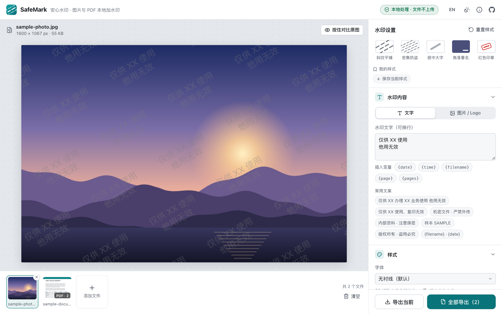
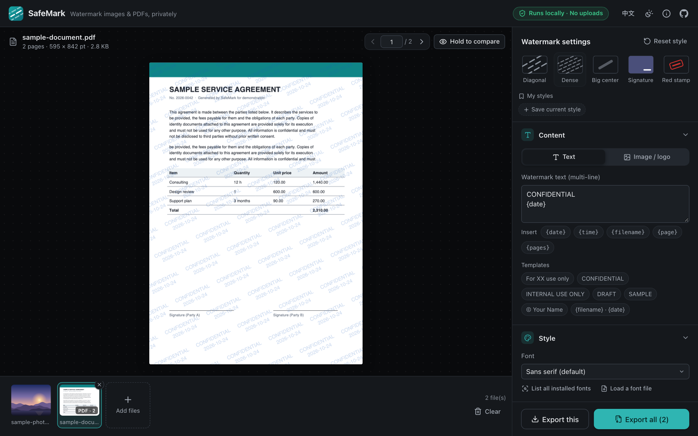
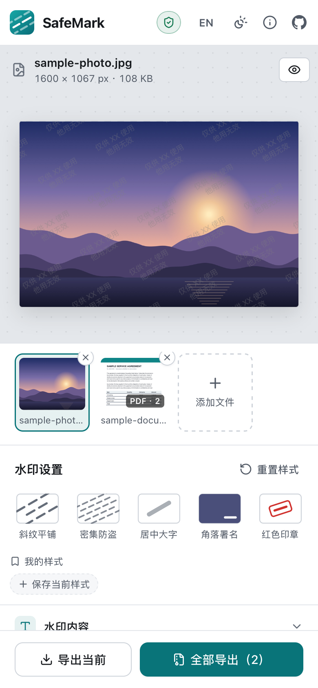

<p align="center">
  
</p>

<h1 align="center">SafeMark · 安心水印</h1>

<p align="center">
  <b>纯本地、零上传</b>的图片与 PDF 加水印工具 —— 文件始终留在你的设备上。
</p>

<p align="center">
  <a href="https://shenyizg.github.io/safemark/"><b>🚀 在线使用</b></a> ·
  <a href="README.md">English</a> ·
  <a href="#-本地开发">本地开发</a> ·
  <a href="#-部署你自己的副本">部署</a>
</p>

<p align="center">
  <a href="https://github.com/shenyizg/safemark/actions/workflows/ci.yml"></a>
  <a href="https://github.com/shenyizg/safemark/actions/workflows/deploy.yml"></a>
  <a href="LICENSE"></a>
</p>

<p align="center">
  
</p>

## 为什么需要它

给身份证、营业执照、合同、报价单打上「仅供 XX 使用」之类的水印，是防止资料被挪用的常见做法。
但很多在线加水印工具需要先把文件**上传到服务器**——这些本来就敏感的文件，反而多了一次泄露的风险。

SafeMark 的所有处理都在你的浏览器里完成：**文件不会离开你的设备**，没有服务器、没有账号、没有统计代码，访问一次之后甚至可以**断网使用**。

## ✨ 功能

**隐私优先**

- 🔒 所有处理在本地完成，文件不上传，不需要注册
- 🛡️ 启用严格的内容安全策略（CSP），浏览器会阻止页面连接任何第三方网站
- 🧹 导出图片时自动移除 EXIF 元数据（拍摄地点、设备型号等）
- 📴 支持离线使用（PWA），也可以安装到桌面或手机主屏幕

**图片与 PDF**

- 🖼️ 支持 JPG、PNG、WebP、GIF、BMP、AVIF、SVG 等常见格式，按原始分辨率输出
- 📄 PDF 两种处理方式：
  - **保留文字**：在原文件上叠加水印，文字仍可选中、搜索，体积几乎不变
  - **转为图片**：每页转为图片并烧录水印，无法用 PDF 编辑器直接删掉
- 🔑 支持加密 PDF（输入密码后处理）、旋转页面、裁剪框、混合页面尺寸
- 📦 批量处理：多张图片、多页 PDF 一次搞定，自动打包为 ZIP；支持拖入文件夹、直接粘贴截图

**丰富的水印选项**

- ✍️ 文字水印：多行文字、字体、字重、斜体、字号、颜色、**不透明度**、字间距、行高、对齐
- 🔤 字体：自动识别本机常见中英文字体；Chrome / Edge 可读取本机全部字体；也可以载入自己的字体文件（.ttf / .otf / .woff2）
- 🧩 布局：
  - **整体平铺**：可调**旋转角度**、横向 / 纵向间距（即**平铺密度**）、交错排列
  - **单个水印**：九宫格定位、边距，或直接在预览图上**拖动**到任意位置
- ✨ 效果：描边、阴影、印章边框，以及「斜纹平铺」「密集防盗」「角落署名」「红色印章」等一键风格
- 🔖 我的样式：把常用的水印设置（含文字）保存为样式，例如「身份证」「照片署名」，一键切换
- 🏷️ 图片水印：使用透明背景的 Logo 作为水印
- 🧮 变量：`{date}` `{time}` `{filename}` `{page}` `{pages}`，例如 `仅供 XX 使用 · {date}`
- 📐 尺寸按图片短边的比例计算：一套设置在手机截图、高清照片和 A4 页面上效果一致

**易用**

- 👀 实时预览，「按住对比原图」，PDF 逐页预览
- 🌏 简体中文 / English，浅色 / 深色主题，适配手机
- ⌨️ 快捷键：`Ctrl/⌘ + O` 打开、`Ctrl/⌘ + S` 导出、`←` `→` 切换文件
- 💾 水印设置自动保存在本机浏览器中，下次打开即可继续使用

<p align="center">
  
  
</p>

## 🔐 隐私是如何保证的

| 措施 | 说明 |
| --- | --- |
| 纯前端 | 整个应用是静态网页，托管在 GitHub Pages 上，没有可以接收文件的后端 |
| 内容安全策略 | `connect-src 'self'` 等规则让浏览器拒绝页面向任何其他网站发送请求 |
| 资源自托管 | pdf.js 的字体、CMap、解码器全部随应用一起部署，不从 CDN 加载任何东西 |
| 无追踪 | 没有统计、广告或第三方脚本；设置仅保存在本机的 `localStorage` |
| 可离线 | Service Worker 只缓存应用自身的文件，断网后照常使用 |

**自己验证：** 打开浏览器开发者工具的「网络（Network）」面板，添加、预览和导出文件时不会出现任何上传请求；或者访问一次后断开网络，应用依然可以正常工作。代码完全开源，欢迎审查。

## 🚀 使用

1. 打开 **<https://shenyizg.github.io/safemark/>**
2. 拖入图片或 PDF（也可以点击选择、粘贴截图，或点「用示例文件试试」）
3. 在右侧调整水印文字、样式和布局，预览实时更新
4. 点击「导出」——单个文件直接下载，多个文件打包为 ZIP

> [!TIP]
> 在微信内打开时可能无法下载文件，请点击右上角「…」选择「在浏览器中打开」。
> 在手机上导出图片后，可以通过系统分享菜单「存储到相册」。

## 💻 本地开发

需要 [Node.js](https://nodejs.org/) `^22.18` 或 `>=24.12`。

```bash
git clone https://github.com/shenyizg/safemark.git
cd safemark
npm install
npm run dev          # 开发服务器 http://localhost:5173
```

| 命令 | 作用 |
| --- | --- |
| `npm run dev` | 启动开发服务器 |
| `npm run build` | 类型检查并构建到 `dist/` |
| `npm run preview` | 预览构建产物 |
| `npm test` | 单元测试（Vitest） |
| `npm run test:e2e` | 端到端测试（Playwright，首次需运行 `npx playwright install`） |
| `npm run lint` / `npm run format` | ESLint 检查 / Prettier 格式化 |

<details>
<summary>项目结构</summary>

```text
src/
├── core/            与界面无关的核心逻辑（可单独测试）
│   ├── render.ts    水印绘制：预览和导出共用同一套代码
│   ├── layout.ts    平铺 / 单个水印的位置计算
│   ├── pdf.ts       PDF 预览、叠加导出（pdf-lib）、转图片导出（pdf.js）
│   ├── image.ts     图片解码与导出
│   ├── fonts.ts     本机字体检测、字体文件载入
│   └── ...
├── state/           应用状态：文件列表、设置、预览缓存、导出流程
├── components/      Vue 组件
├── i18n/            中英文文案
└── styles/          全局样式与主题
scripts/             构建插件（Service Worker 生成）与图标生成脚本
e2e/                 Playwright 端到端测试
```

</details>

## 🌐 部署你自己的副本

本项目是纯静态网站，可以部署到任何静态托管服务。

**GitHub Pages（推荐）**

1. Fork 本仓库
2. 打开仓库的 **Settings → Pages**，将 **Source** 设为 **GitHub Actions**
3. 推送到 `main` 分支（或在 Actions 页面手动运行 *Deploy to GitHub Pages*），稍等片刻即可通过 `https://<你的用户名>.github.io/<仓库名>/` 访问

构建时会根据 `GITHUB_REPOSITORY` 自动设置链接，无需修改配置。使用自定义域名时，可通过环境变量 `SITE_URL` 指定站点地址。

**其他平台**：运行 `npm run build`，把 `dist/` 目录上传到 Cloudflare Pages、Vercel、Netlify、Nginx 等任意静态服务器即可（资源使用相对路径，可部署在任意子目录下）。

## 🛠️ 实现原理

- **渲染**：水印先以不透明方式绘制在独立图层上，再按设定的不透明度合成到图片上，避免描边、阴影和相邻水印叠加处颜色变深；超大图片会分块处理以控制内存占用。预览与导出使用同一套绘制代码，所见即所得。
- **尺寸**：字号、间距、边距都以图片短边为基准，因此批量处理不同分辨率的图片时效果一致。
- **PDF 叠加模式**：用 [pdf-lib](https://github.com/Hopding/pdf-lib) 将透明水印图层叠加到每一页上，正确处理页面旋转（`/Rotate`）与裁剪框；相同尺寸的页面共用同一张水印图片，文件体积几乎不增加。
- **PDF 转图片模式**：用 [pdf.js](https://github.com/mozilla/pdf.js) 按设定的 DPI 渲染每一页，烧录水印后重新组装为 PDF。
- **技术栈**：Vue 3 + TypeScript + Vite，[fflate](https://github.com/101arrowz/fflate) 打包 ZIP，[Lucide](https://lucide.dev/) 图标。

## 🧭 浏览器支持

推荐使用最新版的 Chrome、Edge、Safari 或 Firefox（包括手机浏览器）。目标兼容 Chrome / Edge 100+、Safari / iOS 15.4+、Firefox 100+。

## ❓ 常见问题

<details>
<summary><b>水印能被去掉吗？</b></summary>

任何可见水印都无法做到绝对防护，但可以显著提高挪用成本：

- 使用「整体平铺」并适当提高密度，让水印覆盖关键信息；
- PDF 选择「转为图片」模式，避免水印被 PDF 编辑器直接删除；
- 在水印中写明用途和日期（如 `仅供 XX 办理 XX 业务使用 · {date}`），即使被截取也能追溯。

</details>

<details>
<summary><b>为什么打不开 HEIC 格式的照片？</b></summary>

浏览器能否解码 HEIC 取决于系统：Safari（macOS / iOS）通常可以直接处理，Chrome 等浏览器暂不支持。可以先在手机相册中将照片导出为 JPG，或在 iPhone「设置 → 相机 → 格式」中选择「兼容性最佳」。

</details>

<details>
<summary><b>「转为图片」的 PDF 为什么比原文件大？</b></summary>

每一页都被保存为一张图片。可以在「导出设置」中降低 PDF 分辨率（如 150 DPI）或压缩质量来减小体积；如果不需要防删除，使用「保留文字」模式体积最小。

</details>

<details>
<summary><b>我的设置和文件会被保存吗？</b></summary>

水印设置（以及较小的 Logo 图片）保存在本机浏览器的 `localStorage` 中，方便下次使用；关闭页面后，打开的文件不会被保存在任何地方。清除浏览器的网站数据即可删除这些设置。

</details>

## 🤝 参与贡献

欢迎提交 Issue 和 Pull Request！请先阅读 [贡献指南](CONTRIBUTING.zh-CN.md)。发现安全或隐私问题，请按照 [安全策略](SECURITY.zh-CN.md) 私下报告。

## 📄 许可证

[MIT](LICENSE) © SafeMark contributors
